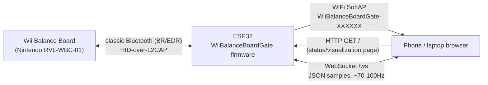
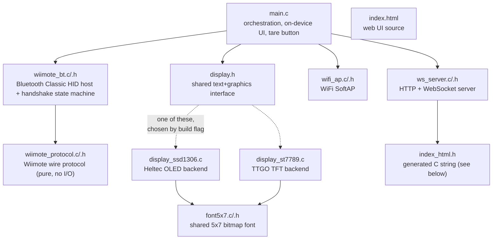
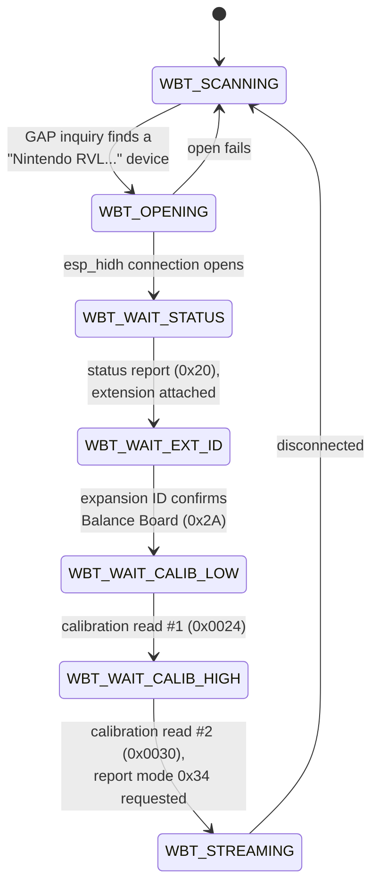

# Architecture

How WiiBalanceBoardGate's pieces fit together. For build/flash instructions
see [README.md](README.md).

## System overview



The ESP32 is the only device that ever has to deal with the board's
non-standard Bluetooth behavior; everything downstream of it is a normal
WebSocket client, so any phone, laptop, or (eventually) a native app can
consume the data without touching Bluetooth at all.

## Source layout



| File | Role |
|---|---|
| `main.c` | Wires everything together: starts the display, WiFi AP, WebSocket server and Bluetooth bridge; owns the on-device status screen layout, the COP panel, and the tare button. |
| `wiimote_bt.c` / `.h` | Everything Bluetooth: GAP inquiry, `esp_hidh` HID host, the connection/handshake state machine, tare offset tracking. |
| `wiimote_protocol.c` / `.h` | Pure protocol logic — builds Wiimote command bytes, parses status/calibration/report-0x34 payloads, calibration interpolation. No I/O; ported byte-for-byte from a known-working reference (the Mac app this project's sibling repo, RombergLab, uses). |
| `display.h` + two backends | A tiny shared interface (`display_init/clear/draw_text/flush` plus `fill_rect/draw_rect/fill_circle`) so `main.c` doesn't care which board it's running on. Selected at build time — see [Two displays, one interface](#two-displays-one-interface). |
| `font5x7.c` / `.h` | The 5x7 dot-matrix font both display backends render text with. |
| `wifi_ap.c` / `.h` | Brings up the SoftAP (unique SSID per chip, see below) and logs WiFi association/disassociation events. |
| `ws_server.c` / `.h` | `esp_http_server` instance serving the web UI at `/` and a WebSocket endpoint at `/ws`, broadcasting to every connected client. |
| `index.html` | The actual web page (Canvas COP visualization, Web Audio deviation feedback, tap-to-set target). |
| `index_html.h` | `index.html` re-encoded as a C string literal, `#include`d by `ws_server.c`. Regenerate it after editing `index.html` (see below) — it is *not* auto-generated by the build. |
| `patch_framework.py` | PlatformIO pre-build script; see [The BTA_SEC_NONE patch](#the-bta_sec_none-patch). |

### Regenerating `index_html.h`

There's no build step for this — after editing `index.html`, regenerate the
header with:

```sh
python3 -c "
with open('src/index.html') as f:
    content = f.read()
with open('src/index_html.h', 'w') as out:
    out.write('#pragma once\n\n')
    out.write('// Generated from index.html - do not hand-edit; regenerate instead.\n')
    out.write('static const char index_html[] =\n')
    for line in content.split('\n'):
        out.write('\"' + line.replace('\\\\', '\\\\\\\\').replace('\"', '\\\\\"') + '\\\\n\"\n')
    out.write(';\n')
"
```

(We tried embedding the HTML via ESP-IDF's/PlatformIO's `EMBED_TXTFILES`
build-system support first; it hit unresolved path and socket-count quirks
in this PlatformIO/ESP-IDF combination. A plain generated C string sidesteps
all of that at the cost of a manual regeneration step.)

## Bluetooth connection state machine

`wiimote_bt.c` drives a small state machine per connection attempt. On any
failure or disconnect, it falls back to `WBT_SCANNING` and starts over —
there's no persistent pairing, so this cycle repeats every time (see
[Why SYNC every time?](#why-sync-every-time)).



Each state corresponds to one outstanding Wiimote command; the report ID of
the next `ESP_HIDH_INPUT_EVENT` (0x20 status, 0x21 read-ack, 0x34 balance
data) tells the handler which state it belongs to. This mirrors the
handshake sequence in RombergLab's `WiiRemote.m` (`connectTo:`) almost
exactly — see that file's comments for the full register-level protocol
reference.

## Two displays, one interface

`display.h` declares a small set of functions; exactly one of
`display_ssd1306.c` / `display_st7789.c` provides real implementations,
guarded by `#ifdef DISPLAY_SSD1306` / `#ifdef DISPLAY_ST7789`. Both files
are always compiled, but only one has actual content per environment — the
other compiles to an empty translation unit. The build flag comes from
`platformio.ini`:

```ini
[env:heltec-lora32-v2]
build_flags = -D DISPLAY_SSD1306

[env:ttgo-t-display]
build_flags = -D DISPLAY_ST7789
```

The OLED backend is monochrome, tiny (128x64), and only implements text.
The TFT backend is color, much bigger (240x135), draws text at 2x scale for
legibility, and additionally implements `display_fill_rect` /
`display_draw_rect` / `display_fill_circle` — `display_has_graphics()`
reports which, so `main.c` only draws the graphical center-of-pressure
panel where there's room for it.

`main.c`'s on-device layout is **stacked**, not side-by-side: status text
rows at the top and bottom, the graphics panel filling the fixed band
between them. This was a deliberate fix after an earlier side-by-side
layout needed to guess how wide the text next to the panel might get, and
got that guess wrong (text and panel overlapped). Stacking with fixed pixel
boundaries between them can't have that class of bug.

## Data flow

Each Wiimote report `0x34` arrives in `wiimote_bt.c`'s `esp_hidh` event
callback, gets parsed into a `wii_bb_sample_t` (raw + calibrated kg values
per corner), has any active tare offset subtracted, and is handed to
`main.c`'s `on_sample` callback. From there:

- It's serialized to JSON and broadcast to every connected WebSocket client
  via `ws_server_broadcast()` — unconditionally, every sample (~70-100Hz).
- The on-device display is redrawn from it, throttled to ~5Hz
  (`SAMPLE_REDRAW_INTERVAL_US`) — far below the sample rate, since neither
  the I2C-driven OLED nor the SPI-driven TFT need or benefit from a faster
  refresh than a human can read.

```json
{
  "seq": 10101,
  "esp_us": 316662000,
  "tr_raw": 2201, "br_raw": 2198, "tl_raw": 2150, "bl_raw": 2340,
  "kg_valid": true,
  "tr_kg": 0.3, "br_kg": 7.7, "tl_kg": -0.1, "bl_kg": 0.8
}
```

`esp_us` is the ESP32's own `esp_timer_get_time()` value, not wall-clock
time — a consumer that needs to line this up with e.g. video frames should
timestamp each WebSocket message on arrival instead (see the discussion
in this project's git history / chat log about syncing with the ArrowForm
iOS app for exactly that reasoning).

The web page (`index.html`) computes center-of-pressure client-side from
the four corner values, lets you tap the canvas to set a target point, and
uses the Web Audio API (`StereoPannerNode` + `OscillatorNode` +
`GainNode`) to pan/pitch a tone based on how far off that target the live
COP is — silent inside an adjustable tolerance ring. None of that state
(target point, tolerance) is known to the firmware; it's purely a browser-
side feature built on the raw stream.

## Known constraints and gotchas

### The `BTA_SEC_NONE` patch

The Balance Board never does a real Bluetooth pairing handshake — no PIN,
no Secure Simple Pairing, nothing. ESP-IDF's classic-BT HID host
(`components/bt/.../btc_hh.c`) hardcodes
`BTA_SEC_AUTHENTICATE | BTA_SEC_ENCRYPT` for both `BTA_HhEnable` and
`BTA_HhOpen`, which makes every connection attempt fail. There's no Kconfig
option to change this, so `patch_framework.py` patches the two call sites
to `BTA_SEC_NONE` directly in the downloaded framework package, as a
PlatformIO `pre:` build script. It's idempotent (checks for a marker
comment) and re-applies itself automatically if the framework package is
reinstalled or updated.

### Why SYNC every time?

Empirically (not just in theory), the board appears to only accept
incoming Bluetooth connections during the ~20s window after its SYNC
button is pressed — a direct connection attempt to its previously-seen
address, skipping the discovery scan entirely, still fails with an HCI
"Page Timeout" if SYNC hasn't just been pressed. An address-remembering
fast-path was prototyped and confirmed this experimentally, then removed
again since it didn't actually remove the need to press the button (see
git history if you want to resurrect it — it's a clean, small diff).

### `esp_http_server` socket limit

`esp_http_server`'s `max_open_sockets` config can't be set arbitrarily
high — it reserves a few sockets for itself out of
`CONFIG_LWIP_MAX_SOCKETS` (default 10). Setting it too high makes
`httpd_start()` fail outright, which — since `ws_server_start()`'s result
is wrapped in `ESP_ERROR_CHECK` — crashes and reboot-loops the whole
device. `ws_server.c`'s `MAX_SOCKETS` constant documents the actual limit;
don't raise it without also raising `CONFIG_LWIP_MAX_SOCKETS`.

### Classic Bluetooth requires the original ESP32

S2/S3/C2/C3/C6/H2 variants don't have a classic BR/EDR radio at all (only
BLE, or nothing). This can't be worked around in software — see the
[README](README.md#hardware-requirements).

### `esp_hidh`'s report-descriptor matching (currently a non-issue, watch for it)

ESP-IDF's `esp_hidh` convenience layer matches incoming HID reports against
the connected device's parsed report descriptor before delivering them as
`ESP_HIDH_INPUT_EVENT`s, and silently drops anything it can't match
(`bt_hidh.c`, `ESP_HIDH_DATA_IND_EVT`, logs `"Not find report handle"`).
The Balance Board's descriptor happens to be well-behaved enough that this
has never been observed in practice on this project's test hardware — but
if you ever see the Bluetooth handshake connect successfully and then never
receive a single `ESP_HIDH_INPUT_EVENT`, that log line is the first thing
to check, and patching that matching logic to fall back to forwarding
unmatched reports (rather than dropping them) is the fix.
