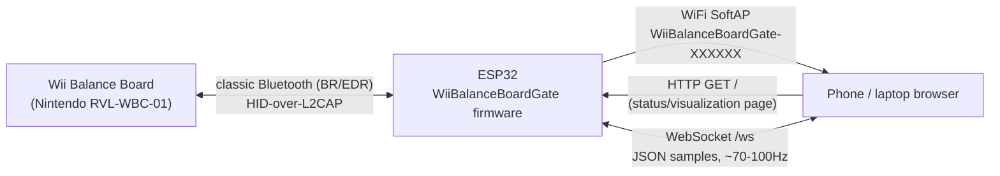
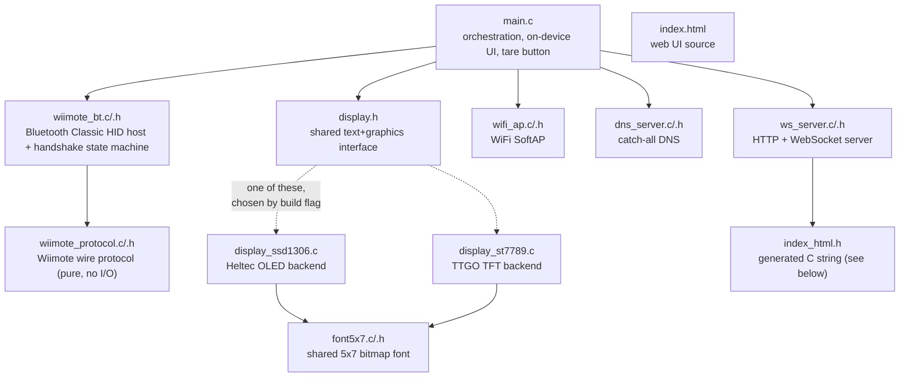
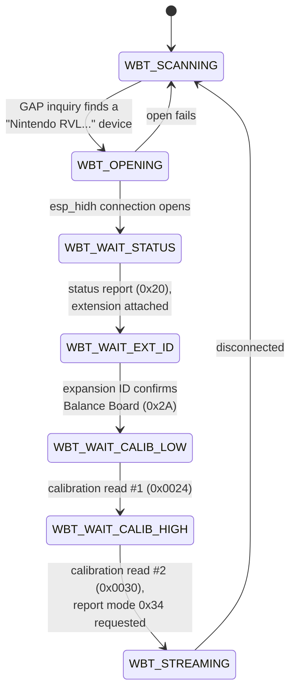
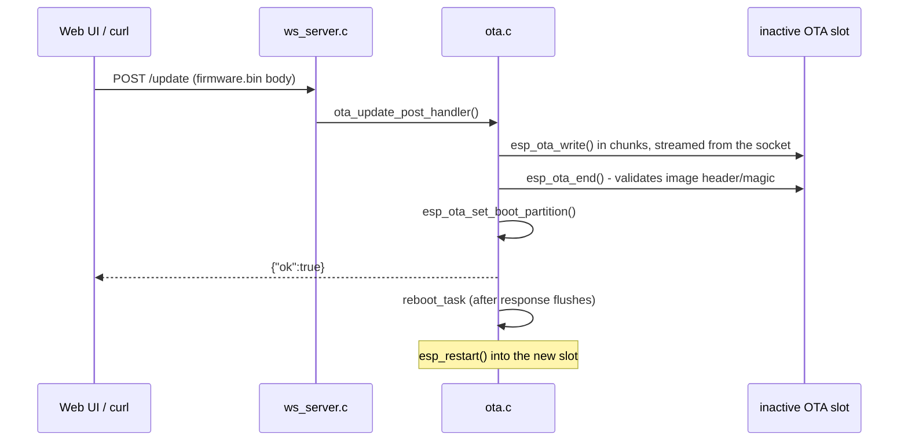

# Architecture

How WiiBalanceBoardGate's pieces fit together. For build/flash instructions
see [README.md](README.md).

## System overview



The ESP32 is the only device that ever has to deal with the board's
non-standard Bluetooth behavior; everything downstream of it is a normal
WebSocket client, so any phone, laptop, or (eventually) a native app can
consume the data without touching Bluetooth at all.

## Source layout



| File | Role |
|---|---|
| `main.c` | Wires everything together: starts the display, WiFi AP, WebSocket server and Bluetooth bridge; owns the on-device status screen layout, the COP panel, and the tare button. |
| `wiimote_bt.c` / `.h` | Everything Bluetooth: GAP inquiry, `esp_hidh` HID host, the connection/handshake state machine, tare offset tracking. |
| `wiimote_protocol.c` / `.h` | Pure protocol logic — builds Wiimote command bytes, parses status/calibration/report-0x34 payloads, calibration interpolation. No I/O; ported byte-for-byte from a known-working reference (the Mac app this project's sibling repo, RombergLab, uses). |
| `display.h` + two backends | A tiny shared interface (`display_init/clear/draw_text/flush` plus `fill_rect/draw_rect/fill_circle`) so `main.c` doesn't care which board it's running on. Selected at build time — see [Two displays, one interface](#two-displays-one-interface). |
| `font5x7.c` / `.h` | The 5x7 dot-matrix font both display backends render text with. |
| `wifi_ap.c` / `.h` | Brings up the SoftAP (unique SSID per chip, see below) and logs WiFi association/disassociation events. |
| `dns_server.c` / `.h` | A ~150-line catch-all DNS responder: answers every A-record query on the SoftAP network with the device's own IP, so any hostname (`http://board/`) resolves without needing mDNS/Bonjour support (which Android browsers resolve unreliably) or the IP address. |
| `ws_server.c` / `.h` | `esp_http_server` instance serving the web UI at `/` and a WebSocket endpoint at `/ws`, broadcasting to every connected client. |
| `index.html` | The actual web page (Canvas COP visualization, Web Audio deviation feedback, tap-to-set target). |
| `index_html.h` | `index.html` re-encoded as a C string literal, `#include`d by `ws_server.c`. Regenerate it after editing `index.html` (see below) — it is *not* auto-generated by the build. |
| `patch_framework.py` | PlatformIO pre-build script; see [The BTA_SEC_NONE patch](#the-bta_sec_none-patch). |

### Regenerating `index_html.h`

There's no build step for this — after editing `index.html`, regenerate the
header with:

```sh
python3 -c "
with open('src/index.html') as f:
    content = f.read()
with open('src/index_html.h', 'w') as out:
    out.write('#pragma once\n\n')
    out.write('// Generated from index.html - do not hand-edit; regenerate instead.\n')
    out.write('static const char index_html[] =\n')
    for line in content.split('\n'):
        out.write('\"' + line.replace('\\\\', '\\\\\\\\').replace('\"', '\\\\\"') + '\\\\n\"\n')
    out.write(';\n')
"
```

(We tried embedding the HTML via ESP-IDF's/PlatformIO's `EMBED_TXTFILES`
build-system support first; it hit unresolved path and socket-count quirks
in this PlatformIO/ESP-IDF combination. A plain generated C string sidesteps
all of that at the cost of a manual regeneration step.)

## Bluetooth connection state machine

`wiimote_bt.c` drives a small state machine per connection attempt. On any
failure or disconnect, it falls back to `WBT_SCANNING` and starts over —
there's no persistent pairing, so this cycle repeats every time (see
[Why SYNC every time?](#why-sync-every-time)).



Each state corresponds to one outstanding Wiimote command; the report ID of
the next `ESP_HIDH_INPUT_EVENT` (0x20 status, 0x21 read-ack, 0x34 balance
data) tells the handler which state it belongs to. This mirrors the
handshake sequence in RombergLab's `WiiRemote.m` (`connectTo:`) almost
exactly — see that file's comments for the full register-level protocol
reference.

## Two displays, one interface

`display.h` declares a small set of functions; exactly one of
`display_ssd1306.c` / `display_st7789.c` provides real implementations,
guarded by `#ifdef DISPLAY_SSD1306` / `#ifdef DISPLAY_ST7789`. Both files
are always compiled, but only one has actual content per environment — the
other compiles to an empty translation unit. The build flag comes from
`platformio.ini`:

```ini
[env:heltec-lora32-v2]
build_flags = -D DISPLAY_SSD1306

[env:ttgo-t-display]
build_flags = -D DISPLAY_ST7789
```

The OLED backend is monochrome, tiny (128x64), and only implements text.
The TFT backend is color, much bigger (240x135), draws text at 2x scale for
legibility, and additionally implements `display_fill_rect` /
`display_draw_rect` / `display_fill_circle` — `display_has_graphics()`
reports which, so `main.c` only draws the graphical center-of-pressure
panel where there's room for it.

`main.c`'s on-device layout is **stacked**, not side-by-side: status text
rows at the top and bottom, the graphics panel filling the fixed band
between them. This was a deliberate fix after an earlier side-by-side
layout needed to guess how wide the text next to the panel might get, and
got that guess wrong (text and panel overlapped). Stacking with fixed pixel
boundaries between them can't have that class of bug.

## Data flow

Each Wiimote report `0x34` arrives in `wiimote_bt.c`'s `esp_hidh` event
callback, gets parsed into a `wii_bb_sample_t` (raw + calibrated kg values
per corner), has any active tare offset subtracted, and is handed to
`main.c`'s `on_sample` callback. From there:

- It's serialized to JSON and broadcast to every connected WebSocket client
  via `ws_server_broadcast()` — unconditionally, every sample (~70-100Hz).
- The on-device display is redrawn from it, throttled to ~5Hz
  (`SAMPLE_REDRAW_INTERVAL_US`) — far below the sample rate, since neither
  the I2C-driven OLED nor the SPI-driven TFT need or benefit from a faster
  refresh than a human can read.

```json
{
  "seq": 10101,
  "esp_us": 316662000,
  "tr_raw": 2201, "br_raw": 2198, "tl_raw": 2150, "bl_raw": 2340,
  "kg_valid": true,
  "tr_kg": 0.3, "br_kg": 7.7, "tl_kg": -0.1, "bl_kg": 0.8
}
```

`esp_us` is the ESP32's own `esp_timer_get_time()` value, not wall-clock
time — a consumer that needs to line this up with e.g. video frames should
timestamp each WebSocket message on arrival instead (see the discussion
in this project's git history / chat log about syncing with the ArrowForm
iOS app for exactly that reasoning).

The web page (`index.html`) computes center-of-pressure client-side from
the four corner values, lets you tap the canvas to set a target point, and
uses the Web Audio API (`StereoPannerNode` + `OscillatorNode` +
`GainNode`) to pan/pitch a tone based on how far off that target the live
COP is — silent inside an adjustable tolerance ring. None of that state
(target point, tolerance) is known to the firmware; it's purely a browser-
side feature built on the raw stream.

The "🏹 60% Vorfuß / 40% Ferse" button (an archery-specific customer
request) is a thin layer on top of the same target-point mechanism: it just
computes `idealPoint` from that ratio instead of a tap, on the same
front/back axis the diagram and audio feedback already use. Front/back
polarity depends on which way the board sits underfoot, which this project
can't know in software - rather than hardcoding a guess, a checkbox next to
the button flips the sign, and a manual canvas tap still overrides the
preset at any time (clearing the button's active state).

## Firmware updates (OTA)

Boards in the field have no USB access and, as SoftAPs, no route to the
internet either - so a pull-based updater (device polls a remote server) was
ruled out in favor of a **local push**: `src/ota.c` exposes `POST /update`
on the same `esp_http_server` instance that already serves the web UI,
accepting a raw `firmware.bin` body and writing it straight into flash via
`esp_ota_ops` (`esp_ota_begin`/`esp_ota_write`/`esp_ota_end`,
`esp_ota_set_boot_partition`). `GET /version` reports the running image's
version (from `esp_ota_get_partition_description`); the web UI's
"Firmware-Update" section wraps both.



### Dual OTA partitions, not a single `factory` partition

`partitions.csv` used to have one `factory` app partition; it's now
`ota_0`/`ota_1` (1700K each, same size the single partition used to be) plus
an 8K `otadata` partition that records which slot is active. This is what
lets an update be written to the *inactive* slot while the board keeps
running the current one untouched - a failed or truncated upload never
touches the running image. Total OTA + `nvs` + `phy_init` footprint is well
under the 4MB flash size this project already requires for BT+WiFi.

Since this partition table change can only take effect via a full USB
reflash (OTA never rewrites the partition table itself), boards flashed
before this existed need exactly one more USB flash to reach it -
[`tools/web-flash/`](../tools/web-flash/) packages that as a browser-based
(ESP Web Tools / WebSerial) flasher a customer can run without installing
PlatformIO, so this isn't a permanent "developer has to drive to the
customer" situation. See [README.md](../README.md#updating-boards-already-in-the-field).

### Rollback protects against a bad image bricking a board

`CONFIG_BOOTLOADER_APP_ROLLBACK_ENABLE=y` (`sdkconfig.defaults`) makes the
bootloader treat a freshly-flashed image as "pending verify" on its first
boot. `main.c` calls `ota_mark_app_valid()` (`esp_ota_mark_app_valid_cancel_rollback()`)
right after everything - WiFi AP, HTTP server, Bluetooth task - has started
without crashing. If a bad image panics or reboot-loops *before* reaching
that call, the bootloader automatically reverts to the previous slot on the
next boot instead of leaving the board stuck - important given these boards
ship to non-technical end users with no USB recovery path at hand.

### Why a raw-body upload instead of `esp_https_ota` or multipart

`esp_https_ota` is built for *pulling* an image from a URL the device
fetches itself - not applicable here since the device has no uplink to pull
from by default (see above; the optional phone-hotspot uplink in
`wifi_ap.c`/`index.html` could theoretically carry internet, but making
updates depend on that being configured would be a worse default than "works
over the board's own AP, always"). A plain `application/octet-stream` POST
body keeps the receiving side to a straightforward `httpd_req_recv()` loop
instead of a multipart parser, and lets the upload be driven equally from
the web UI (`XMLHttpRequest`, for `upload.onprogress`) or a one-line `curl
--data-binary`.

### No image signing (yet)

Anyone who can join the board's WiFi AP and knows its password can push a
firmware image - there's no signature check beyond `esp_ota_end()`'s
built-in header/magic-byte validation. That's an accepted tradeoff for the
current deployment (trusted local network, physical possession implied by
WiFi range), not an oversight; if boards are ever exposed more broadly,
ESP-IDF's signed-app-verification (secure boot) support is the natural next
step, not a redesign of this flow.

## Known constraints and gotchas

### The `BTA_SEC_NONE` patch

The Balance Board never does a real Bluetooth pairing handshake — no PIN,
no Secure Simple Pairing, nothing. ESP-IDF's classic-BT HID host
(`components/bt/.../btc_hh.c`) hardcodes
`BTA_SEC_AUTHENTICATE | BTA_SEC_ENCRYPT` for both `BTA_HhEnable` and
`BTA_HhOpen`, which makes every connection attempt fail. There's no Kconfig
option to change this, so `patch_framework.py` patches the two call sites
to `BTA_SEC_NONE` directly in the downloaded framework package, as a
PlatformIO `pre:` build script. It's idempotent (checks for a marker
comment) and re-applies itself automatically if the framework package is
reinstalled or updated.

### Why SYNC every time?

Empirically (not just in theory), the board appears to only accept
incoming Bluetooth connections during the ~20s window after its SYNC
button is pressed — a direct connection attempt to its previously-seen
address, skipping the discovery scan entirely, still fails with an HCI
"Page Timeout" if SYNC hasn't just been pressed. An address-remembering
fast-path was prototyped and confirmed this experimentally, then removed
again since it didn't actually remove the need to press the button (see
git history if you want to resurrect it — it's a clean, small diff).

### The display isn't reentrant - all callers must go through one mutex

`redraw_header()`, `on_sample()` and `tare_button_task()` each call into
`display.h` functions, but run on three different tasks (the `esp_timer`
task, the Bluetooth event task, and the tare button's own task,
respectively). Neither display backend's SPI/I2C driving code is reentrant
or synchronized internally — two tasks interleaving mid-draw can desync the
panel's addressing state. On the TTGO T-Display this manifested as the
whole device silently freezing (no crash, no log output) shortly after
pressing the tare button while samples were still streaming in; on the
Heltec OLED, the same race showed up as visibly "jumping" rows instead
(I2C being less prone to a hard lock than SPI, apparently, but still
corrupted). `main.c` owns a single `s_display_mutex` that every call site
takes for the whole sequence of display calls it makes, not per-call — the
whole "erase old content, draw new content, flush" sequence needs to be
atomic relative to other tasks, not just each individual draw.

### `httpd_ws_send_frame_async()` is not actually async

Despite the name, and despite being the natural-looking function to call
for "send this to a WebSocket client from outside a request handler",
`httpd_ws_send_frame_async()` performs a synchronous, blocking socket send
in the calling task. Its own header comment says as much: "this API should
rarely be called directly, with an exception of asynchronous send using
`httpd_queue_work`" — the *recommended* pattern queues the actual send onto
the httpd's own internal task via `httpd_queue_work()`, which returns
immediately. `ws_server_broadcast()` originally called it directly from the
Bluetooth event task; a client whose WiFi connection went stale without a
clean close (walked out of range, backgrounded the browser, etc.) could
make the underlying `send()` block for a long time, stalling *all*
Bluetooth processing and display updates right along with it — another
silent, crash-free freeze, this one reachable with a single board and no
tare button involved at all. Fixed by having `ws_server_broadcast()`
`malloc()` a small fixed-size copy of the message and hand it to
`httpd_queue_work()`, so a stuck client can only stall WebSocket delivery,
never the rest of the device.

### `esp_http_server` socket limit

`esp_http_server`'s `max_open_sockets` config can't be set arbitrarily
high — it reserves a few sockets for itself out of
`CONFIG_LWIP_MAX_SOCKETS` (default 10). Setting it too high makes
`httpd_start()` fail outright, which — since `ws_server_start()`'s result
is wrapped in `ESP_ERROR_CHECK` — crashes and reboot-loops the whole
device. `ws_server.c`'s `MAX_SOCKETS` constant documents the actual limit;
don't raise it without also raising `CONFIG_LWIP_MAX_SOCKETS`.

### Classic Bluetooth requires the original ESP32

S2/S3/C2/C3/C6/H2 variants don't have a classic BR/EDR radio at all (only
BLE, or nothing). This can't be worked around in software — see the
[README](README.md#hardware-requirements).

### WiFi/BT radio coexistence can starve BT discovery on boards with less RF margin

The WiFi AP and classic BT share a single radio the whole time the device is
on (`wifi_ap_start()` runs before `wiimote_bt_start()` and neither ever
stops), arbitrated by ESP-IDF's software coexistence layer
(`CONFIG_ESP_COEX_SW_COEXIST_ENABLE`, on by default - the `coexist: coex
firmware version` boot log line confirms it's active). This is usually a
non-issue once streaming: HID input reports are small and interrupt-driven,
and share the radio with WiFi fine. GAP inquiry/paging while **scanning for
or opening** the Balance Board connection is a different story - it needs
much more continuous air time, and loses badly to WiFi beacon/DHCP/AP
traffic on a board with less RF margin (observed concretely on a mini-d1
clone with a "generic"-detected flash chip - it would reliably find and
connect to the Balance Board with the AP off, but essentially never with it
on; a Heltec/TTGO with presumably better RF layout hasn't shown this).

`on_bt_state()` in `main.c` biases the coexistence arbiter with
`esp_coex_preference_set()`: `ESP_COEX_PREFER_BT` for every state up to and
including the handshake, `ESP_COEX_PREFER_BALANCE` once `WIIMOTE_BT_STREAMING`
is reached. This fixed the mini-d1 clone's connection failures in testing
(HCI status went from `0x8`/timeout to `0x0`/success on the very next
attempt) without having to delay or drop the WiFi AP - which would also have
cost the always-available web UI (status page, `/update`) during however
long BT takes to (re)connect, exactly when it's most useful for
troubleshooting.

### `esp_hidh`'s report-descriptor matching (currently a non-issue, watch for it)

ESP-IDF's `esp_hidh` convenience layer matches incoming HID reports against
the connected device's parsed report descriptor before delivering them as
`ESP_HIDH_INPUT_EVENT`s, and silently drops anything it can't match
(`bt_hidh.c`, `ESP_HIDH_DATA_IND_EVT`, logs `"Not find report handle"`).
The Balance Board's descriptor happens to be well-behaved enough that this
has never been observed in practice on this project's test hardware — but
if you ever see the Bluetooth handshake connect successfully and then never
receive a single `ESP_HIDH_INPUT_EVENT`, that log line is the first thing
to check, and patching that matching logic to fall back to forwarding
unmatched reports (rather than dropping them) is the fix.
